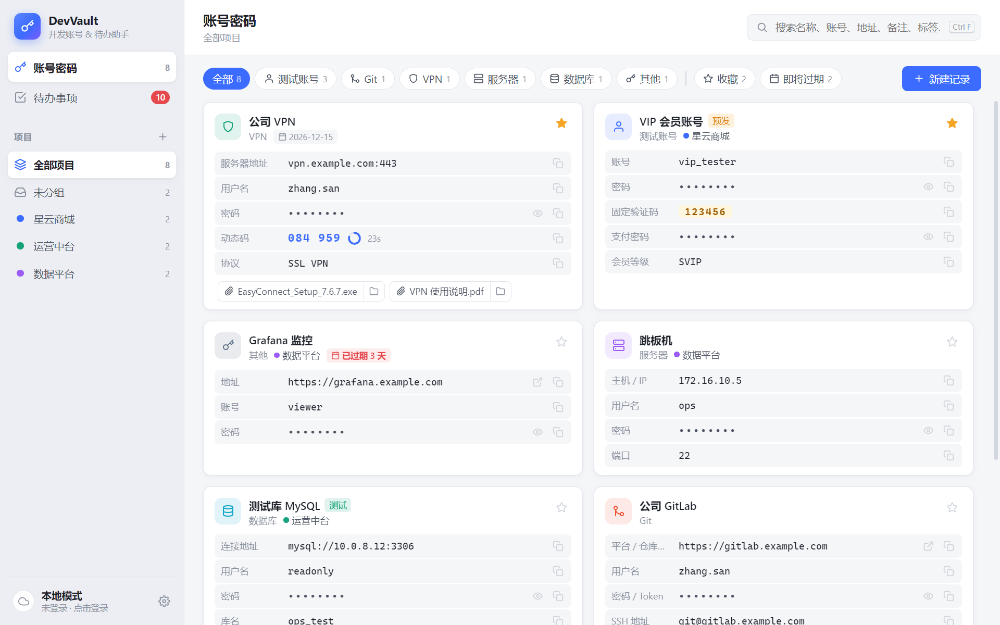
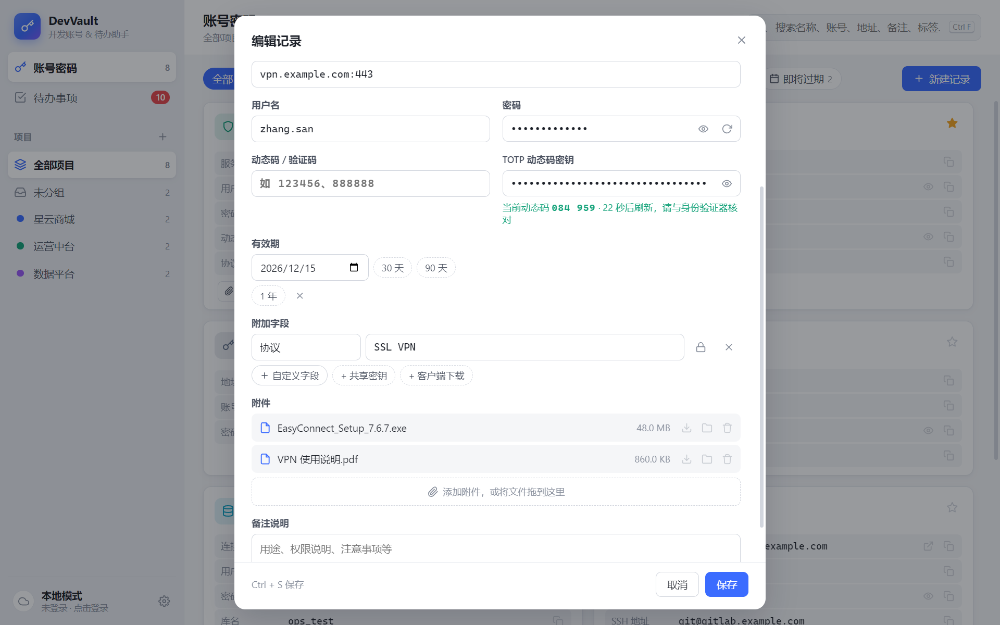
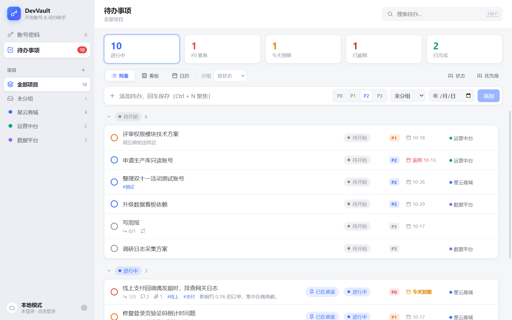
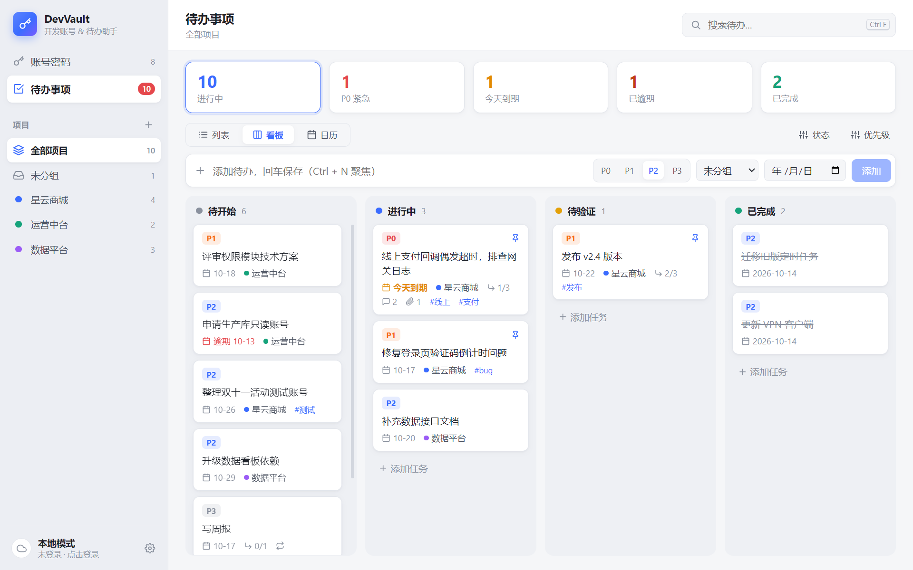
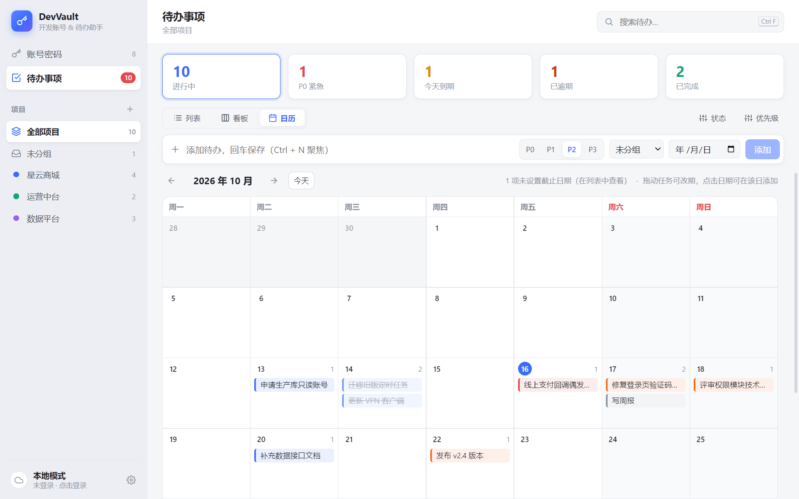
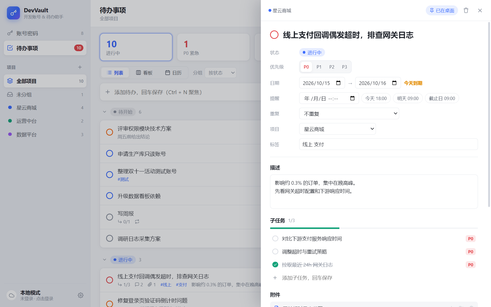
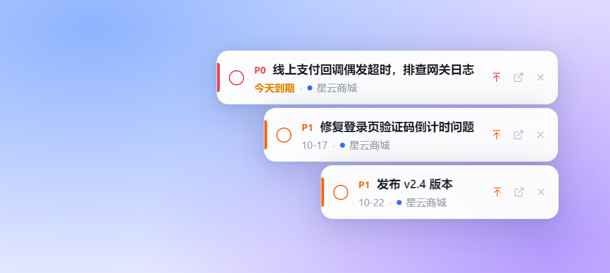
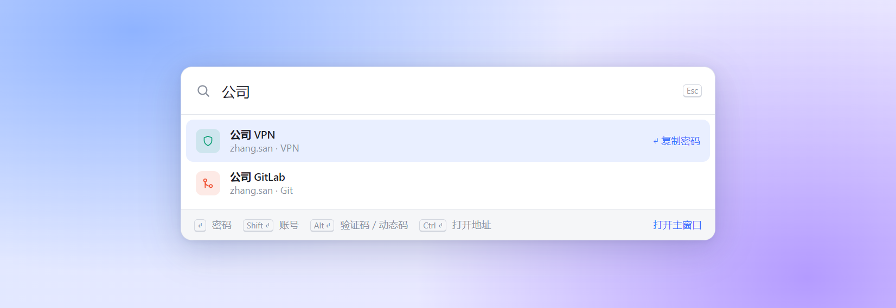
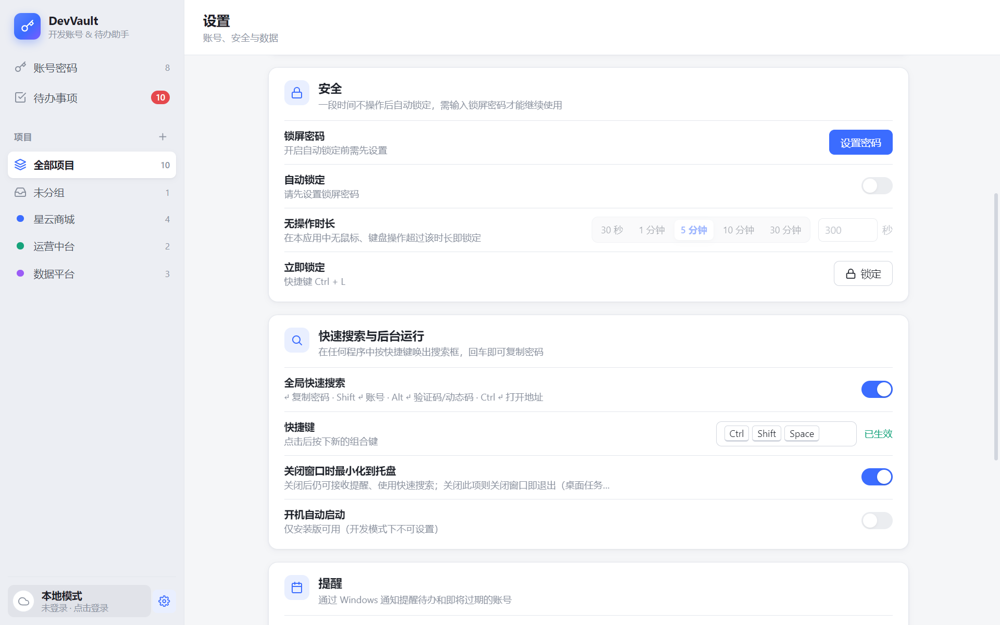
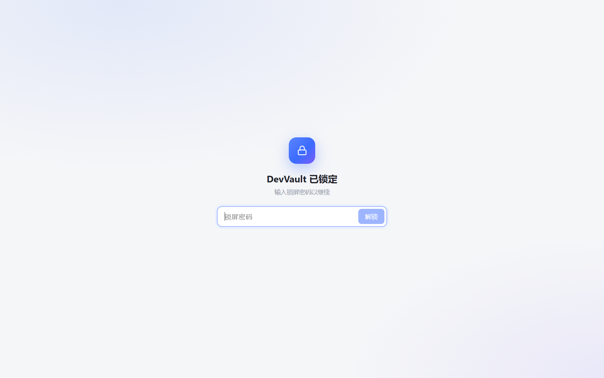

<div align="center">


# DevVault

**给开发者的本地工具箱：测试账号、验证码、Git / VPN 凭据，和你的待办事项，放在一个地方。**


</div>

<p align="center"></p>

日常开发里总有一堆零碎信息：各环境的测试账号、固定的短信验证码、公司 GitLab 的 Token、IT 发的 VPN 客户端和动态码、跳板机地址……散落在聊天记录、便签和浏览器里，用的时候到处翻。

DevVault 把它们按项目整理在一起，配上一个够用的待办系统。所有数据保存在本机，不需要注册账号，也不依赖网络。

> 截图中的所有账号、密码、地址和任务均为演示用的虚构数据。

## 功能

### 按项目整理

侧边栏切换「全部项目 / 未分组 / 具体项目」，账号和待办都按项目归类。删除项目时其下数据自动移入「未分组」，不会丢失。

搜索覆盖名称、账号、地址、验证码、备注、标签、附件名和项目名，空格分隔多个关键词可缩小范围。

### 账号密码

- **六种类型**：测试账号、Git、VPN、服务器、数据库、其他，字段名随类型变化（如 VPN 显示「服务器地址」，Git 显示「密码 / Token」）
- **固定验证码**：测试环境的万能验证码单独高亮，一眼就能找到
- **TOTP 动态码**：粘贴 base32 密钥或 `otpauth://` 链接，卡片上实时显示 6 位动态码和倒计时，不用再掏手机
- **附件**：VPN 客户端安装包、使用说明、证书等直接存进记录，拖拽即可添加，支持打开、另存为、在文件夹中显示
- **有效期**：账号或 Token 快过期时卡片变色提醒，另有「即将过期」筛选
- **环境标签**：开发 / 测试 / 预发 / 生产，生产环境红色标注
- **自定义字段**：支付密码、SSH 地址、协议等，可标记为敏感字段加密存储
- 点击任意值即复制，密码复制后 30 秒自动清空剪贴板；支持收藏置顶、复制为新记录、一键复制整条信息发给同事

<p align="center"></p>

### 待办事项

列表、看板、日历三种视图，顶部统计卡片可一键筛选进行中、最高优先级、今天到期、已逾期、已完成。

<p align="center"></p>

- **自定义状态**：默认 待开始 → 进行中 → 待验证 → 已完成，可改成团队自己的流程（如加一个「提测」）
- **自定义优先级**：默认 P0 ~ P3，名称、颜色、顺序、默认等级都可以改
- **列表**：可按状态、优先级、项目分组并折叠
- **看板**：拖动卡片修改状态
- **日历**：按截止日期排布，拖动即可改期

<p align="center">
  
  
</p>

点击任务打开详情侧栏，所有字段即改即存：

- 描述、开始 / 截止日期、标签、项目
- **子任务**，带完成进度，可逐级打开
- **提醒**：到点弹出 Windows 通知，点击直接打开该任务
- **重复任务**：每天 / 工作日 / 每周 / 每月，完成后自动生成下一次，子任务清单一并带上
- **附件**与**进展记录**（时间线）

<p align="center"></p>

### 桌面任务条

把重要的任务钉到桌面，像便签一样一直看得到：可随意拖动并记住位置，宽度随内容自适应，可切换始终置顶，在任务条上直接点完成。主窗口中的修改会实时同步过来，关闭主窗口后任务条依然保留。

<p align="center"></p>

### 全局快速搜索

在任何程序中按 `Ctrl + Alt + Space`（可在设置中修改）唤出搜索框，不用切换窗口：

| 按键 | 作用 |
| --- | --- |
| `↵` | 复制密码 |
| `Shift + ↵` | 复制账号 |
| `Alt + ↵` | 复制验证码 / 当前动态码 |
| `Ctrl + ↵` | 在浏览器中打开地址 |

应用处于锁定状态时，可以直接在搜索框里输入锁屏密码解锁。

<p align="center"></p>

### 后台与提醒

- 关闭窗口后驻留系统托盘，提醒和快速搜索照常可用（可在设置中改为关闭即退出）
- 每日定时推送摘要：今天到期、已逾期的待办，以及即将过期的账号；错过时间会在下次启动后补发
- 安装版支持开机自启

### 安全

- 密码、动态码密钥和敏感字段使用 Windows DPAPI（Electron `safeStorage`）加密后写入数据库
- 可选的**无操作自动锁定**：设置锁屏密码后，超过设定时间无操作即锁定，启动时同样需要解锁；`Ctrl + L` 立即锁定
- 锁定时主界面整体卸载，主进程同时拒绝数据接口；连续输错 5 次需等待 30 秒
- 锁屏密码以 scrypt 哈希保存，**忘记后无法找回**

<p align="center">
  
  
</p>

## 快捷键

| 快捷键 | 作用 |
| --- | --- |
| `Ctrl + Alt + Space` | 全局快速搜索（可在设置中修改） |
| `Ctrl + F` | 搜索当前页面 |
| `Ctrl + N` | 新建记录 / 聚焦待办输入框 |
| `Ctrl + S` / `Ctrl + Enter` | 在弹窗中保存 |
| `Ctrl + L` | 立即锁定（需已设置锁屏密码） |
| `Esc` | 关闭弹窗 / 清空搜索 |
| 双击卡片 | 编辑记录 |

## 开始使用

需要 Node.js 20 或更高版本，目前仅在 Windows 上测试。

```bash
git clone https://github.com/Chihiro-bit/devvault.git
cd devvault
npm install
npm run dev        # 开发模式（热更新）
```

其他命令：

```bash
npm run typecheck  # 类型检查
npm run build      # 构建到 out/
npm start          # 运行构建产物
npm run dist       # 打包 Windows 安装包到 release/
```

<details>
<summary><b>安装依赖时遇到问题？</b></summary>

**better-sqlite3 编译失败**：项目的 `.npmrc` 已指定直接下载 Electron 33 对应的预编译包，正常情况下不需要 C++ 编译环境。升级 Electron 时请同步修改 `.npmrc` 中的 `target`。npm 11 提示 `Unknown project config` 可以忽略。

**Electron 解压不完整**（`node_modules/electron/dist` 下只有一个 `LICENSES.chromium.html`）：这是较新版本 Node 与 extract-zip 的兼容问题，手动解压缓存即可：

```powershell
$zip = Get-ChildItem "$env:LOCALAPPDATA\electron\Cache" -Recurse -Filter "electron-v33.4.11-win32-x64.zip" | Select-Object -First 1
Expand-Archive $zip.FullName node_modules\electron\dist -Force
Set-Content node_modules\electron\path.txt "electron.exe" -NoNewline
```

</details>

## 数据与隐私

- 所有数据保存在本机：数据库 `%APPDATA%\DevVault\devvault.db`，附件在同目录的 `attachments\` 下（完整路径见「设置 → 数据」）
- 密码通过当前 Windows 用户的凭据加密，**直接拷贝数据库到其他电脑或用户后无法解密**；迁移请使用「设置 → 数据」中的导出 / 导入
- 导出的备份是一个文件夹（`data.json` + `attachments/`），其中密码为**明文**，请妥善保管，不要提交到代码仓库或发到群里；导入时选择 `data.json`，按追加合并，同名项目 / 状态 / 优先级自动复用
- 附件以原文件保存，**未加密**
- 自动锁定用于防止离开座位时被他人查看，不等同于对整个数据库加密

## 项目结构

```
src/
  main/        主进程：窗口与托盘、SQLite（db.ts 迁移 / repo.ts 数据访问）、
               IPC、加密、附件、提醒、自动锁定、云端客户端
  preload/     通过 contextBridge 暴露类型安全的 window.api
  shared/      主进程与渲染进程共享的类型
  renderer/    React 界面：主窗口、桌面任务条（widget）、快速搜索（quick）
resources/     应用与托盘图标
docs/          服务端接口约定、截图
```

## 云端服务（规划中）

后续计划提供多设备同步、团队共享等需要登录的功能。客户端的登录流程已经实现，服务端接口约定见 [docs/server-api.md](docs/server-api.md)。不登录不影响任何本地功能。
